# Stockki

> Enterprise-grade, multi-tenant inventory management and product expiry tracking platform with automated optical label recognition, real-time shelf-life safety alerts, user role-based access control (RBAC), ultra-modern glassmorphic design system (Light Theme default with toggleable Dark Mode), and native multi-language support.

[](https://github.com/KaioBorges-Dev/Stokki)
[](https://php.net)
[](https://laravel.com)
[](https://flutter.dev)
[](https://postgresql.org)
[](https://tailwindcss.com)
[](LICENSE)

---

## 1. System Overview

**Stockki** is engineered for businesses, warehouses, pharmacies, and food retail operators requiring strict batch lifecycle tracking, shelf-life monitoring, and stock level controls. Designed with a clean multi-tenant boundary, every workspace operates with strict data isolation and granular permission enforcement.

### Key Highlights
- **Ultra-Modern Glassmorphic UI**: High-end modern design system built with frosted glass surfaces (`backdrop-blur-xl`), curated soft lighting gradients, and smooth micro-interactions.
- **Light Theme Default with Dark Mode Switch**: Clean, crisp light theme set as default with instant toggle to sleek dark mode, persisted across sessions.
- **High-Converting Landing Page**: Public presentation page with hero showcase, interactive KPI metrics, feature architecture, and conversion funnels.
- **Split-Screen Authentication**: Left side featuring a 3D holographic logistics visual with floating parallax glass cards; right side featuring a clean, responsive login and workspace registration form.
- **Tenant Data Isolation**: Every resource belongs to a tenant workspace (`user_id`), enforced at both database schema and Eloquent query-scope levels.
- **Full Inventory CRUD**: Create, read, update, and remove products with SKU, batch number, current quantity, safety stock thresholds, and expiry deadlines.
- **Expiry Lifecycle Tracking**: Dynamic visual indicators categorizing inventory into `Safe`, `Expiring Soon (< 30 days)`, and `Expired`.
- **User Management & RBAC**: Administer workspace team members, assign predefined roles (`Administrator`, `Inventory Manager`, `Stock Operator`), configure granular permissions (`manage_inventory`, `manage_users`, `view_reports`, `scan_products`), and toggle active/deactivated statuses.
- **Dual-Mode Optical Recognition**: Capture packaging labels using the device's live camera (`getUserMedia`) or upload image files, automatically extracting SKU, batch number, and expiry date.
- **Internationalization (i18n)**: Out-of-the-box dual locale support (English `en` as primary default, Portuguese `pt`), unified between web dashboard (`__()`) and Flutter mobile clients (`AppLocalizations`).
- **Complete Deployment Guide**: Full installation and hosting documentation including step-by-step setup on **cPanel** shared and VPS environments in [DOCUMENTATION.md](DOCUMENTATION.md).

---

## 2. Visual Interface & Feature Showcase

### 2.1 Public Landing Page
Clean, high-converting product landing page with live shelf-life metrics and interactive CTA triggers.

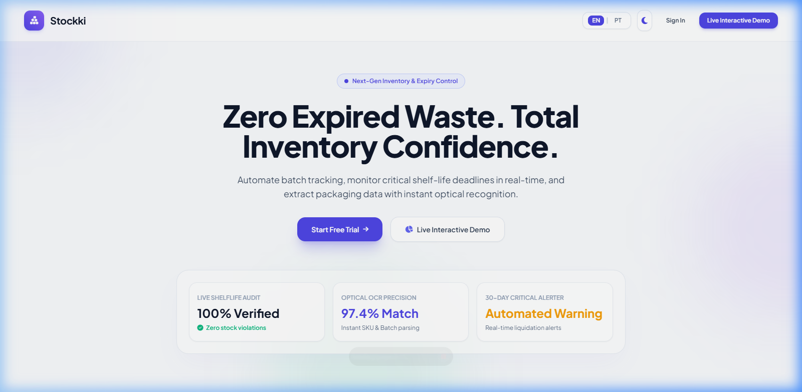

---

### 2.2 Split-Screen Workspace Sign-In (`/login`)
Left-side 3D floating parallax glass cards highlighting core security features, paired with a right-side glassmorphic login form with 1-click demo credential access.

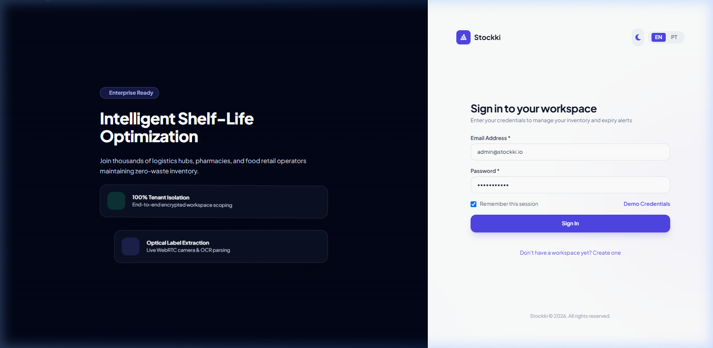

---

### 2.3 Split-Screen Workspace Registration (`/register`)
Tenant onboarding form allowing business owners to register their workspace, assign administrative credentials, and establish isolated database boundaries.

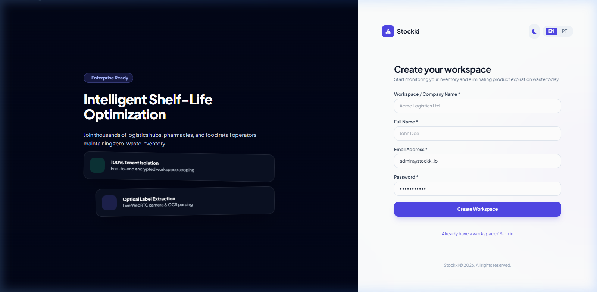

---

### 2.4 Ultra-Modern Dashboard — Light Theme Default (`/dashboard`)
Crisp, airy glassmorphic dashboard showcasing real-time KPI metrics (`Total Products`, `Expired`, `Expiring in < 30 days`, `Low Safety Stock`), inventory health distribution bar, and urgent attention alerts.

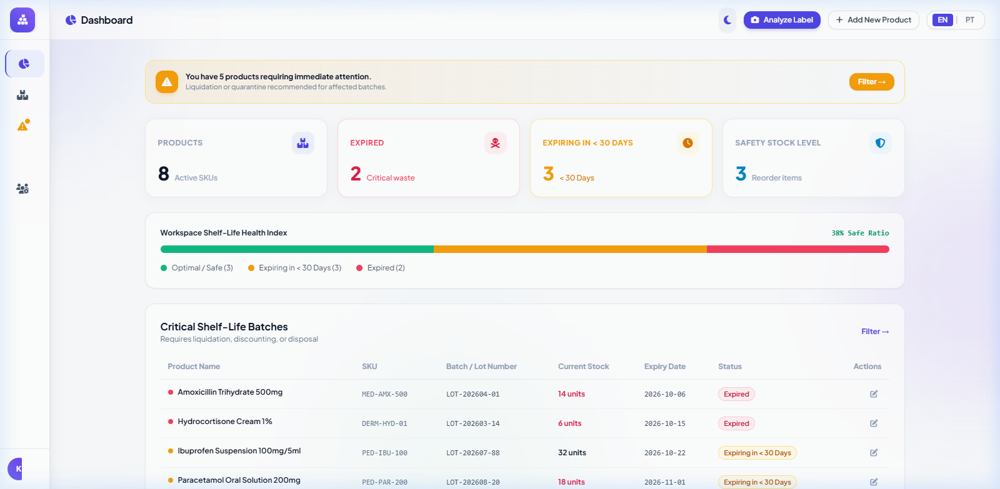

---

### 2.5 Ultra-Modern Dashboard — Secondary Dark Mode Toggle
Seamlessly switch between Light and Dark modes with a single click, preserving glassmorphism frosted effects, glowing pill indicators, and high contrast.

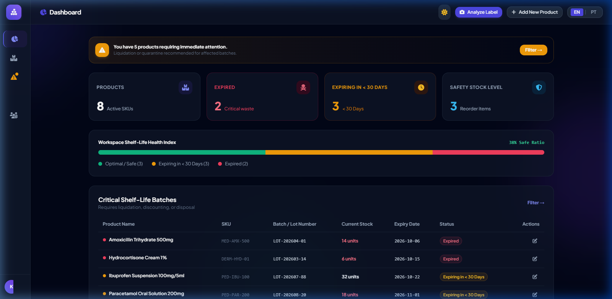

---

### 2.6 Inventory Management Table (`/inventory`)
Full inventory table featuring search by name, SKU, or batch number, filter tabs (All, Safe, Expiring Soon, Expired), status badges, safety stock limits, and action controls.

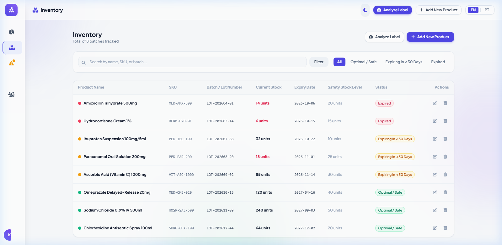

---

### 2.7 Product Edit & Update Form (`/inventory/edit`)
Directly modify stock quantities, batch assignments, manufacture and expiry dates, and minimum safety thresholds with instant database updates.

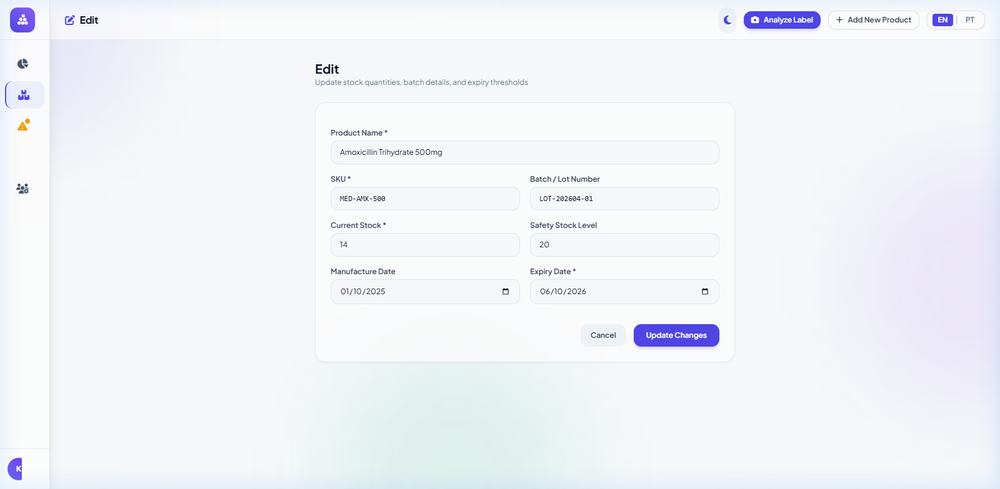

---

### 2.8 Dedicated Expiry Alerts Center (`/inventory/expiry-alerts`)
Targeted dashboard categorizing urgent stock into "Expired" and "Expiring within 30 Days" cards with remaining days countdowns.

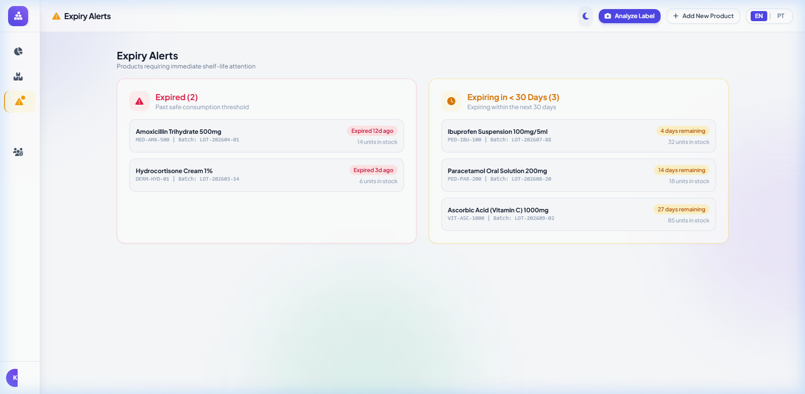

---

### 2.9 Dual-Mode Optical Recognition & Camera Scanner (`/recognition`)
Real-time WebRTC camera stream with viewfinder laser overlay and instant snapshot capture for automated OCR label parsing.

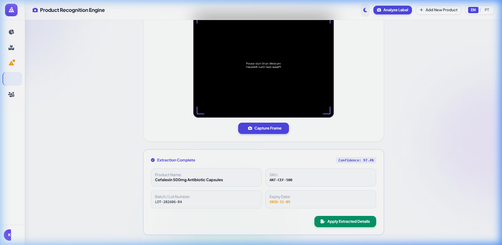

---

### 2.10 User Management & Role-Based Permissions (`/users`)
Manage workspace team accounts, assign roles (`Admin`, `Manager`, `Operator`), inspect granted permissions, and toggle active/deactivated statuses with a single click.

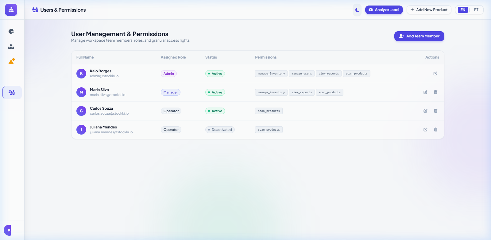

---

### 2.11 User Creation & Permission Configuration Form (`/users/create`)
Configure user credentials, assign functional roles, and grant granular checkboxes for inventory management, user administration, reporting, and scanning.

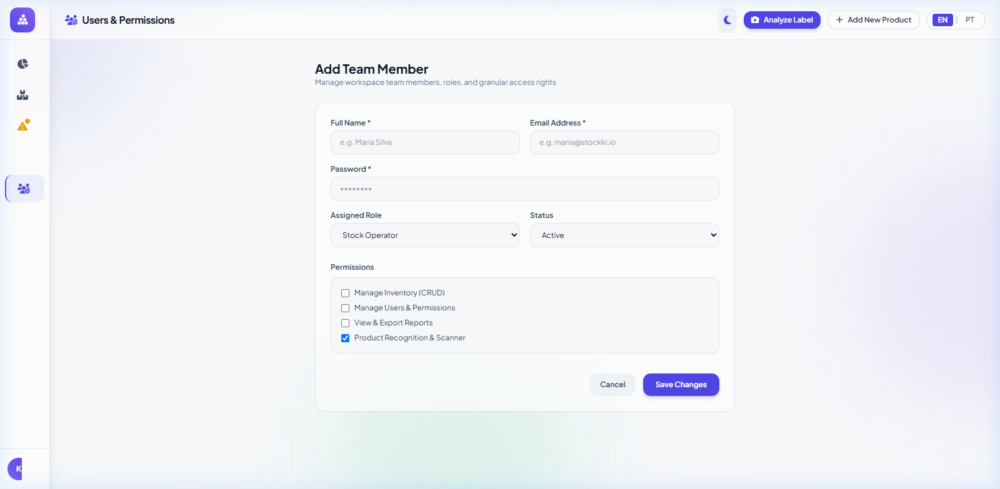

---

## 3. Technology Stack

| Layer | Technology | Key Capabilities |
| :--- | :--- | :--- |
| **Backend API** | PHP 8.3+ & Laravel 11 | Domain-driven modular structure in `app/Modules/`, lightweight `bootstrap/app.php` |
| **Database** | PostgreSQL 15+ (MySQL / SQLite compatible) | UUIDv4 primary keys, `timestamptz` timestamp precision, `jsonb` metadata & permissions storage |
| **Web UI** | Blade + TailwindCSS + Alpine.js | Light-default glassmorphic design system, dark mode toggle, WebRTC camera scanner |
| **Mobile Client** | Flutter 3.x (Dart 3+) | Feature-first clean architecture, offline-ready caching, camera OCR capture |
| **Authentication** | Laravel Sanctum / JWT | Stateless multi-tenant bearer token authentication |

---

## 4. Architecture & Repository Layout

```
backend/
├── app/
│   ├── Modules/
│   │   ├── Auth/
│   │   │   ├── Controllers/AuthController.php
│   │   │   ├── Models/User.php
│   │   │   └── Routes/api.php
│   │   ├── Inventory/
│   │   │   ├── Controllers/ProductController.php
│   │   │   ├── Models/Product.php
│   │   │   └── Routes/api.php
│   │   └── Recognition/
│   │       ├── Services/ProductRecognitionService.php
│   │       └── Routes/api.php
├── bootstrap/
│   └── app.php                   # Modern Laravel 11 application pipeline
├── database/
│   ├── migrations/
│   │   ├── 0001_01_01_000000_create_users_table.php
│   │   └── 2026_01_01_000001_create_products_table.php
│   └── init_dev_db.php           # SQLite local development & seeder script
├── docs/
│   └── screenshots/              # 11 production UI visual captures
├── lang/
│   ├── en/messages.php           # Primary default locale keys
│   └── pt/messages.php           # Portuguese locale keys
├── mobile/                       # Flutter 3.x Clean Architecture
│   ├── l10n.yaml
│   ├── lib/
│   │   ├── core/localization/app_localizations_setup.dart
│   │   └── l10n/
│   │       ├── app_en.arb
│   │       └── app_pt.arb
├── public/
│   ├── assets/auth_showcase.jpg  # 3D visual showcase asset
│   └── index.php                 # Responsive application front controller
├── DOCUMENTATION.md              # Complete installation & cPanel hosting guide
└── README.md
```

---

## 5. Local Development Setup

### 5.1 Quick Start Commands

```bash
# 1. Clone repository
git clone https://github.com/KaioBorges-Dev/Stokki.git
cd Stokki

# 2. Initialize development database & seeders
php database/init_dev_db.php

# 3. Start local development server
php -S 127.0.0.1:8000 -t public public/index.php
```

Visit `http://127.0.0.1:8000` in your web browser. Default administrator login:
- **Email**: `admin@stockki.io`
- **Password**: `password123`

### 5.2 Complete Production & cPanel Guide

For production deployment instructions, domain routing, directory security outside `public_html`, SSL configuration, and automated expiry alert cron jobs on cPanel, please review:
👉 **[DOCUMENTATION.md](DOCUMENTATION.md)**

---

## 6. Credits & Copyright

Desenvolvido por **Kaio Borges Dev** ([dev.kaioborges.com.br](https://dev.kaioborges.com.br/)) — **5E Group** ([@5ebrasil](https://instagram.com/5ebrasil)). Todos os direitos reservados.

---

## 7. License

This project is licensed under the terms of the [MIT License](LICENSE).
